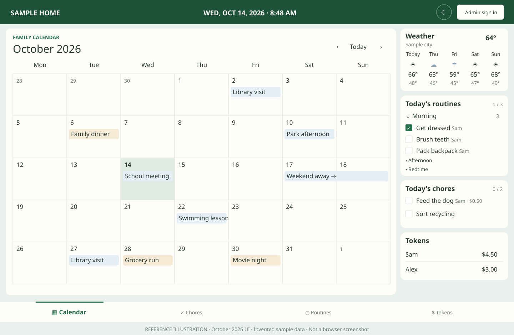

# Family Hub


A private household calendar and task app for one home. It runs as one service with a local database.

**[Run it](#run-it) · [Add a display](#add-a-display) · [Develop locally](#develop-locally)**

## At a glance



*Reference illustration based on the October 2026 UI, not a browser screenshot.
All names, events, balances, and weather are invented sample data. Weather and
token balances are optional. Phones use a compact agenda instead of this wide
calendar layout.*

## Run it

Use the published image and `compose.yaml`. You choose the host tool. Family Hub does not install or update the host for you.

1. Copy `.env.example` to `.env`.
2. Set `SITE_URL` to the address you type in the browser, such as `http://hub.home.example:3000`. Do not add a trailing slash.
3. Set `FAMILY_HUB_VERSION` to an immutable image tag.
4. Run `docker compose pull` and `docker compose up -d`.
5. Open that same address. Restore a backup or create the first adult.

Keep port 3000 on your private network. Use HTTPS before phones install the app or you use it across networks. Do not forward port 3000 to the internet.

Backups are downloaded from **Settings**, then **Access**. A backup is the whole household. Keep it private.

See the [published image guide](docs/published-image.md) and the [update and recovery guide](docs/update-and-recovery.md).

## Settings

Settings keep separate Display, Screens, Calendars, Routines, Weather, Household,
Access, and Integrations sections. All section tabs remain visible on phones.
Routines configure the household widget independently of calendars.

- Preference forms use explicit Save buttons, including token visibility.
  Unsaved edits stay in this browser tab. Leaving a section or the settings view
  asks before discarding edits. Failed saves keep the draft for retry.
- Household preferences apply to all displays. The header light/dark toggle is
  local to the current browser. Screen pairing and revocation are under Screens.
  A layout preview is not a live screenshot; Last seen is the last screen report.
- Weather and calendar settings show connection status and last successful
  refresh when known. Checks happen during normal dashboard/calendar requests.
  Attempt history resets when the service restarts; the weather cache retains
  its last successful fetch time. Provider failures do not expose raw errors.
- Saved weather keys are not returned to the browser. Leave the replacement key
  blank to keep the saved key. The Show replacement key checkbox reveals only
  text you enter, not the saved key.
- Access separates account controls, backup download, installed version, and
  restoration. Restore replaces household data and restarts the service. Save a
  current backup first. Updates remain a host-owner operation.

## Add a display

The display computer only runs Chromium. It does not run the application.

Download `install-display.sh` and `install-display.sh.sha256` from a selected
[release with display assets](https://github.com/3d6564/family-hub/releases).
On the signed-in graphical account, verify and run the saved installer:

```sh
sha256sum -c install-display.sh.sha256
bash install-display.sh http://hub.home.example:3000/
```

Use the same address as `SITE_URL`. Read the saved script before running it.

The screen shows a code. On your phone, open **Settings**, then **Screens**, and enter the code. The screen does not need a keyboard. Run the installer again to update it. Leave the address off to keep the current one.

An unchanged running display is left running. Configuration changes restart the
browser without removing its profile or pairing. Labwc startup is configured
automatically. Known older kiosk startup entries are migrated. See the
[display automation guide](docs/display-automation.md) to use this installer
with Ansible or another host tool.

Use `--check` to preview changes and `--json` for structured automation results.
Every run checks for supported prior installs. The installed display version is
recorded separately from the application version.

## Change the Hub address / fix a kiosk

Use one permanent HTTPS address on your laptop, phone, and Pi. First confirm
the Pi can resolve it and trusts its certificate, and save a current backup.
Update Family Hub to a release with **Reconnect** under Screens before starting.

1. Set `SITE_URL` to the new address and redeploy with the same data volume.
2. On the Pi, as its desktop user (not with `sudo`), run your saved, verified
   installer from **Add a display**. Replace the example address:

   ```sh
   bash install-display.sh https://hub.home.example/
   ```

3. Open the new address on your laptop and sign in. In **Settings > Screens**,
   click **Reconnect** on the existing screen and enter the code shown on the Pi.

The command updates kiosk startup and restarts its browser without deleting its
profile. Reconnect keeps the screen's name and record; old access is replaced
only when the new page collects its connection. Do not revoke the old screen or
clear browser data first. If the code expires, use the new code shown on the Pi.
Changing `SITE_URL` alone does not update the kiosk address.

## Develop locally

Requirements: Node.js 22 and npm.

```sh
cp .env.example .env
npm install
npm start
```

Open `http://localhost:3000`. Run `npm run check` and `npm test` before a change is merged.

Optional settings browser checks use an already installed Chromium binary, with
no added package. Set `FAMILY_HUB_TEST_BROWSER` to its executable path before
running `npm test`. These checks use sample API responses and a temporary browser
profile, never a live household. Without that variable, the browser test is
reported as skipped.

## Limits

- One household per deployment.
- Calendar feeds are read-only.
- The host owner deploys the image. Family Hub does not deploy a host.
